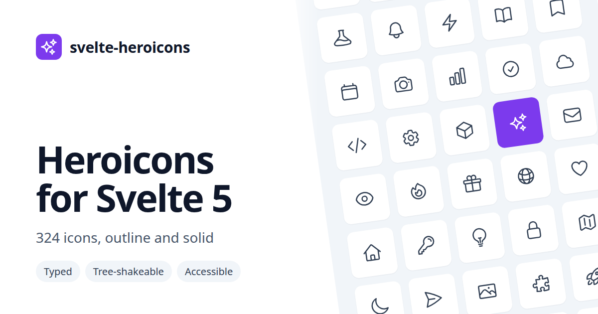

# svelte-heroicons



[Heroicons](https://heroicons.com) for Svelte 5: all 324 icons in the 24px outline and solid styles, through one typed `<Icon name>` component or as separate tree-shakeable components.

Search the icons and copy their code in the [icon browser](https://krowten.github.io/svelte-heroicons/). Every icon has its own page there with the code and the raw SVG.

## Installation

```sh
npm install @krowten/svelte-heroicons
```

Requires Svelte 5.

## Usage

Render any icon with `Icon` and its heroicons name:

```svelte
<script>
	import { Icon } from '@krowten/svelte-heroicons';
</script>

<Icon name="beaker" class="size-6 text-blue-500" />
<Icon name="beaker" class="size-6 text-blue-500" solid />
```

`name` is typed as `IconName`, a union of all icon names, so a typo is a type error. Use the type for your own props:

```svelte
<script lang="ts">
	import { Icon, type IconName } from '@krowten/svelte-heroicons';

	const { icon }: { icon: IconName } = $props();
</script>

<Icon name={icon} class="size-5" />
```

`Icon` includes all 324 icons, about 65 KB gzipped. If bundle size matters, import the icons you use as components instead; only those end up in your bundle:

```svelte
<script>
	import { BeakerIcon } from '@krowten/svelte-heroicons';
	// or: import BeakerIcon from '@krowten/svelte-heroicons/icons/BeakerIcon.svelte';
</script>

<BeakerIcon class="size-6 text-blue-500" solid />
```

Component names are the heroicons names in PascalCase with an `Icon` suffix: `arrow-up-tray` is `ArrowUpTrayIcon`.

AI assistants can read [llms.txt](https://krowten.github.io/svelte-heroicons/llms.txt), or [llms-full.txt](https://krowten.github.io/svelte-heroicons/llms-full.txt) with every icon name and its component.

## Props

| Prop          | Type               | Default | Description                                  |
| ------------- | ------------------ | ------- | -------------------------------------------- |
| `solid`       | `boolean`          | `false` | Render the solid variant instead of outline. |
| `strokeWidth` | `number \| string` | `1.5`   | Stroke width of the outline variant.         |
| `name`        | `IconName`         | —       | `Icon` only: which icon to render. Required. |

Any other attribute or event handler (`class`, `style`, `fill`, `onclick`, …) is passed through to the `<svg>` element and overrides the defaults.

## Styling

Icons use `currentColor`, so they take the text color of their parent or of a class like `text-gray-500` in [Tailwind CSS](https://tailwindcss.com). Icons are 24×24 by default through `width` and `height` attributes, so they never collapse or stretch to fill their container; any CSS size, like `class="size-5"`, takes precedence.

## Accessibility

Icons are decorative by default and rendered with `aria-hidden="true"`. Give an icon an `aria-label` (or `aria-labelledby`) and it is exposed to screen readers as an image instead:

```svelte
<button>
	<Icon name="trash" class="size-5" aria-label="Delete" />
</button>
```

## Development

```sh
bun install
bun run dev          # the site at http://localhost:5173
bun run generate     # regenerate src/lib from the installed heroicons package
bun run test         # generated files check, unit and component tests, e2e
bun run check        # svelte-check
bun run lint
```

The files in `src/lib/icons/`, `src/lib/icon-set.ts` and `src/lib/index.ts` are generated from `node_modules/heroicons`. After updating `heroicons`, run `bun run generate` and commit the result. Component tests run in Chromium; install it once with `bunx playwright install chromium`.

`bun run build` builds both the site (`build/`) and the package (`dist/`). The site's own code lives in `src/routes` and `src/site`, outside the package. Every push to `main` deploys it to GitHub Pages (`.github/workflows/pages.yml`).

To release, set `version` in `package.json`, move the CHANGELOG entries under it and push a `v<version>` tag. `.github/workflows/release.yml` runs the tests and stages the release on npm with provenance; it goes live once approved on npmjs.com.

## License

MIT © Vladimir Kraikovskii. Icons are [Heroicons](https://github.com/tailwindlabs/heroicons) by Tailwind Labs, MIT licensed.
